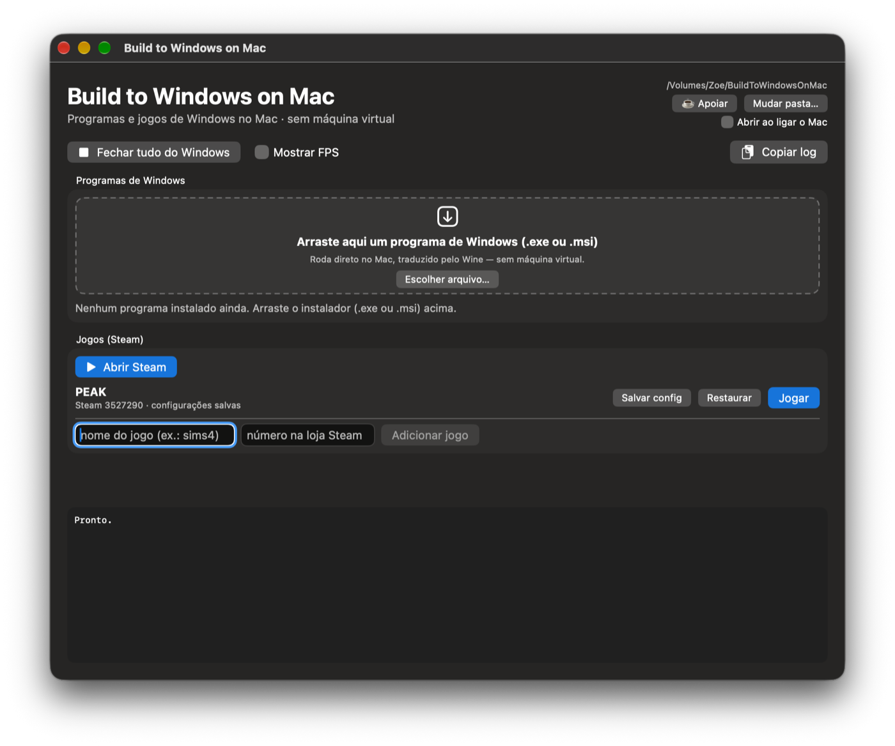

# Build to Windows on Mac

**Rode programas e jogos de Windows no seu Mac com chip Apple — de graça e sem máquina virtual.**

Arraste um `.exe` ou `.msi` para o app e ele abre direto no macOS. Não tem um Windows inteiro rodando por baixo: o [Wine](https://www.winehq.org) traduz as chamadas do Windows para o macOS em tempo real, e o **D3DMetal** da Apple (do Game Porting Toolkit) traduz os gráficos de DirectX 11/12 para Metal.



## O que ele faz

- **Arrastar e soltar:** solte um instalador `.exe`/`.msi` na janela, ou clique com o botão direito no arquivo → *Abrir com → Build to Windows on Mac*.
- **Lista de programas:** tudo o que você instala aparece na janela e no menu da barra de cima, com um botão *Abrir*.
- **Jogos pela Steam (opcional):** instala a Steam de Windows com um clique; cada jogo ganha um perfil com as configurações e correções dele.
- **Escala certa em qualquer tela:** antes de abrir cada programa, o app confere a tela (Retina interna, monitor externo, resolução) e ajusta a escala do Windows — nada de janela gigante nem letra minúscula.
- **Fica em segundo plano:** fechou a janela, o app continua na barra de menus. Dá para abrir junto com o Mac.
- **Instala sem internet:** a tradução já vem dentro do instalador. Com internet, o app avisa quando sai uma versão nova aqui no GitHub — o motor só muda quando uma versão testada é publicada.
- **Leve:** o instalador tem ~260 MB; a tradução instalada ocupa ~1 GB.

## Requisitos

- Mac com chip Apple (M1, M2, M3, M4 ou mais novo)
- macOS 14 Sonoma ou mais novo
- Rosetta 2 (o app avisa se faltar e mostra o comando)

## Instalação

1. Baixe o `.dmg` mais recente em **[Releases](../../releases)**.
2. Abra o `.dmg` e arraste **Build to Windows on Mac** para **Aplicativos**.
3. Abra o app. Como ele ainda não é assinado pela Apple, o macOS pode bloquear na primeira vez:
   *Ajustes do Sistema → Privacidade e Segurança →* role até o fim → **Abrir Mesmo Assim**.
4. Clique em **Instalar**. Você pode escolher outra pasta antes (um SSD externo, por exemplo).

## Testado

| Programa / jogo | Resultado |
|---|---|
| Steam (cliente de Windows) | ✅ abre, login e downloads funcionando |
| PEAK (Unity 6, DirectX 12) | ✅ 30–40 FPS num MacBook Air M4 com *Render Scale* em Medium |
| Bloco de Notas do Windows | ✅ nítido e na escala certa |

Testou outro programa? Abra uma [issue](../../issues) contando se funcionou — isso ajuda todo mundo.

## O que não funciona (ainda)

- **Jogos com anti-cheat de kernel**, como Valorant e Fortnite — não rodam fora do Windows.
- **Softwares profissionais com proteção de licença pesada ou drivers próprios** (muitos CAD/BIM, como AutoCAD e Revit). Programas mais simples costumam funcionar; vale testar.
- **Macs com Intel.**

## Como funciona por dentro

```
seu .exe ──► Wine (traduz o Windows para o macOS) ──► macOS
              │
              └─ DirectX 11/12 ──► D3DMetal / DXMT ──► Metal (GPU do Mac)
```

- **Motor:** Wine 10 da [Sikarugir](https://github.com/Sikarugir-App) (`WS12WineSikarugir10.0_6`), rodando pelo Rosetta 2.
- **Tradutores gráficos:** D3DMetal (Apple) por padrão; DXMT e o wined3d do Wine como alternativas por programa.
- **App:** SwiftUI ([`app/main.swift`](app/main.swift)); toda a lógica fica no lançador [`scripts/zog.sh`](scripts/zog.sh), que também funciona pelo Terminal (`zog.sh` sem argumentos mostra os comandos).

### Compilar você mesmo

Precisa só das Command Line Tools da Apple (`xcode-select --install`):

```bash
git clone https://github.com/ZoeDrewLabs/build-to-windows-on-mac.git
cd build-to-windows-on-mac
app/build.sh
```

O script baixa o motor e os tradutores nas versões testadas e gera `dist/Build to Windows on Mac.app` e o `.dmg`.

## Licença

O código deste repositório está sob a **[PolyForm Strict 1.0.0](LICENSE.md)**:

- ✅ **Pode usar de graça**, para fins pessoais e não comerciais (inclui escolas, ONGs e órgãos públicos).
- ❌ **Não pode redistribuir** o app nem o código — baixe sempre daqui, da página de [Releases](../../releases).
- ❌ **Não pode cobrar** pelo app, vender, nem usar em produto ou serviço comercial.
- ❌ **Não pode publicar versões modificadas.**

Quer usar de outro jeito? Fale comigo abrindo uma [issue](../../issues).

## Créditos e licenças de terceiros

Este projeto junta e automatiza o trabalho de outras pessoas, e cada parte mantém a licença original:

- **[Wine](https://www.winehq.org)** — LGPL 2.1. Código-fonte em [gitlab.winehq.org/wine/wine](https://gitlab.winehq.org/wine/wine).
- **[Sikarugir](https://github.com/Sikarugir-App)** — builds do Wine para macOS e o pacote de tradutores (veja as licenças no repositório deles).
- **D3DMetal**, do Game Porting Toolkit da **Apple** — distribuído sob a licença da Apple que acompanha o pacote (`License.rtf`).
- **[DXMT](https://github.com/3Shain/dxmt)** e **[MoltenVK](https://github.com/KhronosGroup/MoltenVK)**.

O Build to Windows on Mac não é afiliado à Apple, à Valve, à Microsoft nem à CodeWeavers. Windows é marca da Microsoft; Steam é marca da Valve.

## Apoie ☕️

O app é gratuito. Se ele foi útil, considere pagar um café:

- **LivePix:** [livepix.gg/zoedrewerro404](https://livepix.gg/zoedrewerro404)
- **Pix (CNPJ):** `54.913.468/0001-04`
